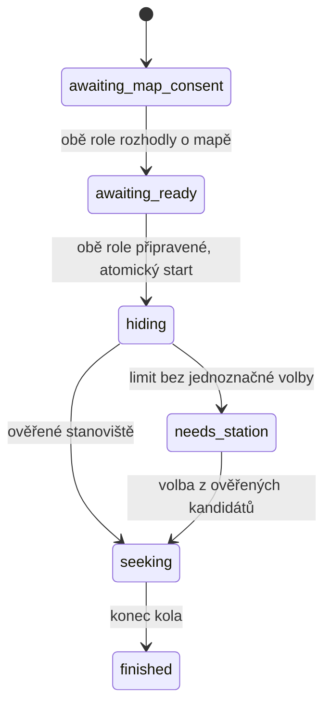

# Začátek partie, časomíra a Hidden Hangman

Standardní **Nová hra** vytvoří nové UUID, čistý stav, balíček a dedukční epochu. Historie, otázky, ruka, odměny, prokletí, Move a stanoviště se nepřenášejí. Oba telefony otevřou úvod partie. Seed, velikost a geografické varianty jsou technická konfigurace; původní GPS lze výslovně zachovat přepínačem v administraci. Tato nastavení nikdy nenahrazují rozhodnutí role.

## Start na telefonech

`createLobbyGame()` zachovává historické rozhraní `createGame()`, používané i deterministickými scénáři. Nový proces má `uxVersion: 1` a uložený `lobby`:

Na **každém telefonu** jsou samostatné volby Ano / Bez zakreslování. Zapnuto je pouze po dvou Ano. Jakmile obě role rozhodnou, oba telefony zobrazí konečnou dohodu a vlastní tlačítko **Jsem připraven**. Jedno potvrzení čas nespouští. Druhé nastaví jediný `startedAt`, deadline schovávání a fázi `hiding`. Opakovaný příkaz či dvojklik nemění začátek hry. Po startu nelze souhlas změnit. Jádro odmítá předčasné herní příkazy.

Administrátorské testovací scénáře smějí nastavit dokumentované simulované souhlasy a rozehranou fázi. **Nová hra** vždy prochází telefony, bez ohledu na tuto konfiguraci. Reálný serverový transport není implementován; lokální rozhodnutí nejsou autorizací skutečných hráčů. Úvod i karty v režimu `live` nadále vyžadují autoritativní server.

## Čas

Oba telefony ukazují **Celkový čas hry: HH:MM:SS**, před oboustrannou připraveností nulu. Během schovávání navíc souběžně běží **Čas na výběr stanoviště: MM:SS**. Celkový čas se při uzamčení stanoviště ani uplynutí 45 minut neresetuje: 45 + 30 minut je **01:15:00**.

Autoritativní čas a role DTO oddělují skutečný interval od startu (`wallElapsedMs`), započítávaný čas (`elapsedMs`), pauzy Move (`pausedMs`), bonusy (`bonusMs`), penalizace (`penaltyMs`) a jednotlivé termíny úkolů. Bonusy se do hlavních hodin nepřičítají; uplatní se ve výsledku. Move zachovává celý dvacetiminutový odpočet i předchozí pravidla uzamčení a obnovy času.

Simulátor ponechává vlastní ovládání rychlosti a pauzy. Před startem neposouvá herní hodiny ani přes tlačítko +5 minut; druhé potvrzení připravenosti automaticky rozběhne i čas simulátoru. Potom jej lze výslovně pozastavit, změnit rychlost nebo používat časové kroky. Reload zachová uloženou pauzu a znovu nespouští již zahájenou partii. Nejde o časový server ani běh hodin na pozadí zavřeného prohlížeče.

## Navigace, odměny a upozornění

Spodní navigace vždy otevírá kořen sekce a resetuje pouze místní podnavigaci. Přímé upozornění na rozpracovaný Thermometer otevře jeho aktivní měření. Otázky, nabídky karet, prokletí a odpočty zůstávají v jádře i po přepnutí nebo reloadu.

Po odpovědi se zobrazí **Odpověď odeslána. Můžeš si líznout nové karty.** a akce s konkrétním počtem lízni/ponech. Zahájené dobírání je před ostatními odměnami a rukou. Před otevřením lze zahrát současné karty. Po otevření se obnovuje přesně uložená nabídka, bez nového losování. Badge Karty zobrazuje počet odměn; `!` označuje otevřený nedokončený výběr.

`gameIndicators()` odvozuje upozornění z role DTO. Nemá vlastní ztratitelný stav v Reactu:

| Stav | Priorita | Role / cíl | Zmizí při |
| --- | ---: | --- | --- |
| Probíhající Move | 100 | Obě / Mapa | Ověřeném dokončení |
| Překročená ruka | 95 | Schovaný / Karty | Zmenšení ruky |
| Hangman, nové slovo, cooldown | 90 | Hledači / Prokletí; schovaný / Karty | Zrušení nebo výhře |
| Blokující prokletí | 88 | Hledači / Prokletí | Splnění či vypršení bloku |
| Nedokončené dobírání | 85 | Schovaný / Karty | Potvrzení výběru |
| Příchozí otázka / čekající odpověď | 80 | Obě / příslušná otázka | Odpovědi nebo Vetu |
| Čekající odměna | 70 | Schovaný / Karty | Dokončení dobírání |
| Výsledek či selhání úkolu | 60 | Příjemci události / detail | Vlastním **Rozumím** |

Potvrzení výsledkového upozornění je uložené v jádře pro každou roli zvlášť; nesplní skutečný úkol. Blokující prokletí má nahoře nad otázkami banner **Nejdřív musíte zrušit prokletí.** s podmínkou, termínem a přímou akcí. Blok vždy samostatně vynucuje Game Core.

## Pražský Hidden Hangman

Nové balíčky mají `hangmanVersion: 1`. Casting cost je karta prokletí a **dvě další karty**; cena a aktivace jsou jedna transakce. Po aktivaci schovaný zadává tajné slovo, při dalším pokusu až po skončení čekání.

- Přesně pět českých písmen, Unicode NFC, porovnání bez ohledu na velikost. Diakritika se rozlišuje; CH obsadí dvě pozice. Číslice, mezery, cizí abecedy a interpunkce se odmítají.
- **Slovník českých slov nebyl dodán.** UI výslovně uvádí dočasný režim ručního potvrzení platnosti slova. Jádro vyžaduje toto potvrzení a kontroluje tvar, nepředstírá slovníkové ověření.
- Správné písmeno odhalí všechny jeho pozice. Opakované písmeno ani stejný příkaz nepřidají chybu nebo duplicitní událost.
- Sedm chybných písmen znamená prohru. Hned začíná **10 minut** čekání; hádání, nové slovo, otázky a nástup do další dopravy jsou blokované.
- Po čekání schovaný zadá nové slovo. Po **třetí prohře a posledním úplném čekání** se prokletí zruší.
- Odkrytí všech pěti pozic okamžitě znamená výhru a zrušení bloků.
- **Pravidlo chybného tipu celého slova není ověřeno.** Samostatný tip slova je proto odmítnut; slovo se uzná odkrytím všech pozic. Nevymýšlí se další penalizace.
- Digitální odpovědi se počítají ihned. Volitelné `manualHangmanResponses: true` uloží čekající tip a přesný 30sekundový termín; schovaný tlačítkem odpoví podle uloženého slova. Bez odpovědi se prokletí automaticky zruší. Výchozí režim tento timeout nemá. Manuální režim je připraven také jako skutečný scénář simulátoru.

Stav obsahuje ID prokletí, soukromé slovo, odhalené pozice, použitá písmena, chyby, prohry, cooldown, čekající odpověď a audit všech pokusů. Import kontroluje jejich konzistenci a termíny. Tajné slovo se neobjevuje v událostech ani upozorněních a **odstraňuje se i z historie pokusů v DTO hledačů**. Hledačům není dostupné generické ruční potvrzení výhry či splnění. Obě role vidí automatický výsledek.

Správce lokálního simulátoru vlastní celou simulaci a může výslovně otevřít její interní stav nebo provést soukromý export. To není pohled telefonu hledačů ani veřejné herní API. Pro skutečnou hru by autoritativní soukromý stav musel zůstat na serveru.

## Kompatibilita a ověření

Starší exporty a rozpracované partie bez nových verzí zůstávají ve své původní fázi a pravidlech. Není bezpečné jim měnit prokletí či souhlasy uprostřed hry. Pro nové chování použijte **Nová hra**. Editorové drafty, geodata, release schémata, SHA-256, PID a publikační autorizace se nemění.

Dvacet nových scénářů `ux-*` a `hangman-*` používá skutečné sdílené komponenty a jádro. Jednotkové testy ověřují start, oba souhlasy, atomickou připravenost, 75 minut, Unicode, sedm chyb, cooldowny, tři prohry, soukromí, timeout, idempotenci, import a historické formáty. Produkční E2E pokrývají telefony, odměny, navigaci, oba režimy Hangmana, reload, mobilní rozložení a absenci síťového odesílání. Dosavadní E2E nadále ověřují geografii, Move, karty, fotografie i oddělené prohlížeče. CI v `.github/workflows/pages.yml` zahrnuje nové testy automaticky před publikací Pages.
